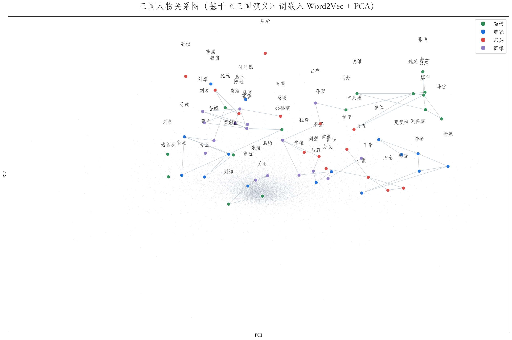

# NLP Transformers Projects

基于 Transformers 和 NLP 技术的项目集合，涵盖机器翻译、问答系统、词嵌入可视化等方向。

## 项目列表

| 项目 | 方向 | 技术栈 |
|------|------|--------|
| 机器翻译质量评估 | 评估指标 | NLTK、jieba、BLEU |
| 中英双向翻译 | 机器翻译 | Transformers、MarianMT、OPUS-MT |
| Transformer 问答 | 抽取式问答 | DistilBERT、BERT |
| 三国人物关系图 | 词嵌入可视化 | Word2Vec、PCA、gensim |

## 项目说明

### 1. 机器翻译质量评估（BLEU）
实现 BLEU 指标，评估英文与中文翻译质量。
- 英文：按空格分词
- 中文：jieba 分词后计算
- 支持 n-gram 阶数对比、平滑处理、多参考译文

### 2. 中英双向翻译（OPUS-MT）
基于 Hugging Face 的 OPUS-MT 预训练模型，实现英译中、中译英。
- 模型：opus-mt-en-zh、opus-mt-zh-en
- 框架：PyTorch + Transformers

### 3. Transformer 问答
基于 DistilBERT 和 BERT 的抽取式问答。
- 英文：distilbert-base-multilingual-cased
- 中文：bert-multi-cased-finetuned-xquadv1
- 输入问题 + 上下文，输出答案

### 4. 三国人物关系图
基于《三国演义》全文，生成人物关系图。
- 流程：jieba 分词 → Word2Vec 词嵌入 → PCA 降维 → 相似度连线
- 可视化：按阵营着色，展示 60 位主要人物



## 技术栈

- 编程语言：Python
- 深度学习：PyTorch、Transformers
- NLP 工具：jieba、NLTK、gensim
- 可视化：Matplotlib、scikit-learn

## 环境安装
```
pip install torch transformers sentencepiece sacremoses jieba nltk gensim scikit-learn matplotlib
```
